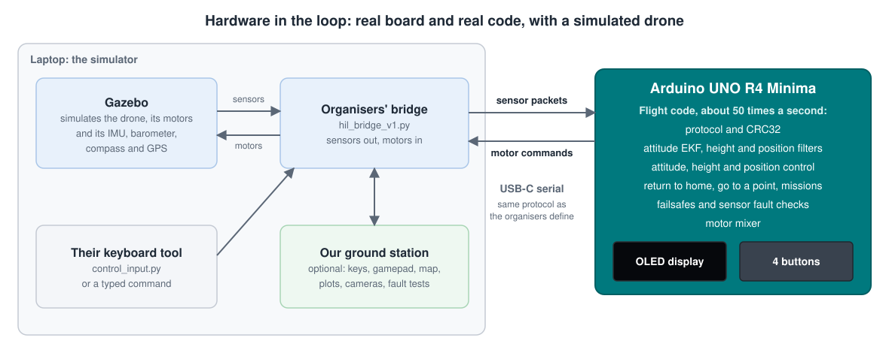
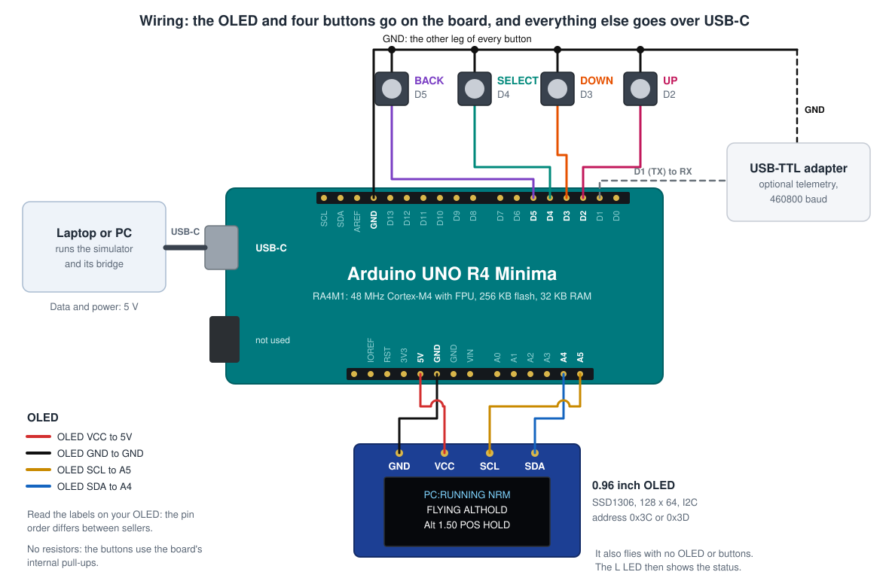
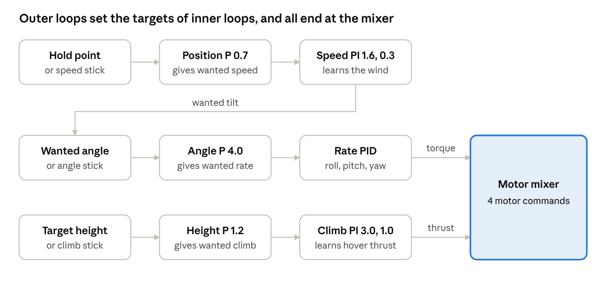
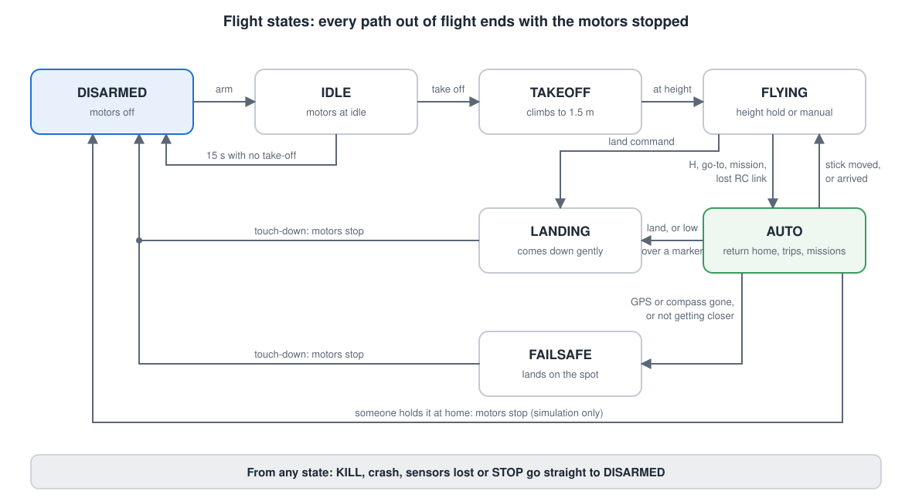

# AeroFC-R4

**A complete quadcopter flight controller on an Arduino UNO R4 Minima, flown in a Gazebo hardware-in-the-loop simulator.**

   

About 50 times a second the board reads the sensors, works out how the drone is tilted and where it is, and computes four motor commands. Only the drone is simulated, so the code runs with real timing and real delays on real hardware, and a bug crashes a simulated drone and not a real one. It started as an entry for the Aerovidya 2026 hackathon.



## What it does

| | |
|---|---|
| **Estimates** | Attitude EKF with gyro-bias learning, height filter, position filters, GPS-aided attitude, a heading learned from GPS when the compass is wrong |
| **Flies** | Cascaded PID control of attitude, height and position, heading hold, a thrust-linearised mixer, speed modes, position hold that learns the wind |
| **Flies by itself** | Return to home like a DJI drone, fly to a marked point, missions of up to 16 points, landing on a marker with a camera |
| **Stays safe** | RC-loss detection (silence, too few packets, invalid packets), a stuck compass, a GPS that jumps, a stuck IMU, crash detection, arming checks, watchdog |
| **Needs nothing else** | An OLED and four buttons show and change everything on the board, with live plots and a help page for every setting. No libraries and no other program |
| **Ground station** (optional) | A web page with keyboard and gamepad, a click-to-fly map, plots, a fault panel, and gestures and object detection on the laptop's cameras |

## Wiring

Only an OLED and four buttons, and it also flies without them. Details are in [docs/02](docs/02_wiring.md).



## Which boards work

| Board | Status |
|---|---|
| **Arduino UNO R4 Minima** | **Flown:** every result below is from this board |
| Arduino Nano R4 | Builds with no changes, never flown |
| Arduino UNO R4 WiFi | Builds, never flown. Its USB goes through an ESP32, which is slower |
| Other 32-bit boards with a floating-point unit | Need a small port: only 6 files touch the hardware, and the flight code in `src/core` has no Arduino functions |
| Arduino UNO R3, classic Nano, Mega | Can't run it: it needs 16 KB of RAM, and an UNO R3 has 2 KB |

[docs/16](docs/16_other_boards.md) has the sizes, and how to port it to another board.

## Try it

### With nothing but a Windows PC

Needs Python and Edge or Chrome. Double-click `START_SIMULATOR.bat`, then press **Fly the software FC**. The same flight code flies a replica of the drone in your browser, with no board and no Gazebo. Open `simulator/tests.html` to watch the automated flight tests run.

### With the simulator

The real test is in **[the UAV HIL Simulator](https://github.com/Pramod-Gurav/uav-hil-simulator)**, the simulator the hackathon's organisers provide. It isn't part of this repository, and it belongs to its authors. It needs Ubuntu 22.04 and Gazebo Harmonic. On Windows that means WSL, and everything is scripted.

1. Download the simulator from the link above.
2. Follow [the first-time set-up in docs/08](docs/08_gazebo_wsl_setup.md#set-it-up-for-the-first-time). It takes 10 to 20 minutes.
3. **Without a board:** double-click `START_ALL.bat`. The same flight code runs as a program on the PC.
4. **With the R4 Minima:** wire it, plug it in, run `UPLOAD_FIRMWARE.bat`, then `START_ALL.bat`.

`STOP_ALL.bat` stops everything. `START_ALL camera` adds the down camera and a landing pad.

The board also flies with **only** the simulator's own files, with nothing of ours on the laptop:

```bash
./start_gazebo.sh --gui                                                # terminal 1
python3 arduino_hil/hil_bridge_v1.py --port /dev/ttyACM0               # terminal 2: it takes off by itself
python3 arduino_hil/control_input.py --interactive                     # terminal 3: fly with the keys
python3 arduino_hil/control_input.py --throttle 22 --duration 0.2      # return to home
python3 arduino_hil/control_input.py --throttle 23 --roll 10 --pitch 5 --yaw 3 --duration 0.2      # go 10 m north, 5 m east, 3 m up
```

[docs/12](docs/12_hand_over_sheet.md) is a one-page sheet for this.

### Uploading with the Arduino IDE

Open `firmware/AeroFC_R4/AeroFC_R4.ino`, choose **Arduino UNO R4 Minima**, and press Upload. No libraries are needed. See [docs/03](docs/03_upload_and_first_run.md).

## Flying

Keys work while the Gazebo window or the page is active, with no click on the page.

| Key | What it does | Key | What it does |
|---|---|---|---|
| `W` `S` | Forward, back | `T` | Take off |
| `A` `D` | Left, right | `L` | Land |
| `Q` `E` | Turn left, right | `H` | Return to home |
| `R` `F` | Up, down | `Backspace` | **KILL:** motors stop at once |

Let go of the sticks and it brakes and holds its spot. Move a stick to take over from anything it is doing by itself. All the keys and the gamepad are in [docs/04](docs/04_flying_controls.md).

## How it works

Outer loops set the targets of inner loops. Each one is faster and more direct than the one before:





[docs/06](docs/06_how_it_works.md) is a beginner's tour of every algorithm: the EKF, the Kalman filters, PID control, the mixer, the protocol and CRC32, GPS aiding, and what happens when each sensor goes wrong.

## Tested how

Everything flown is judged by **Gazebo's own true position**, not by what the flight controller believes. `RUN_ALL_TESTS.bat` runs it all and writes a dated report.

**On the real R4 Minima: 86 of 86 checks pass**, on the final firmware, in Gazebo through the simulator's own bridge. The same tests without the board, and 58 tests in the browser replica, run the same flight code.

| What | Measured on the R4 Minima |
|---|---|
| Return to home after a lost RC link, from 30 m in 8 directions | Worst 0.030 m from home, then holds 2 m within 0.046 m |
| Flying to 20 random points up to 50 m away | Worst 0.085 m off |
| Landing on the camera's marker, from 3 directions | Within 0.002 m of its centre |
| Attitude estimate against Gazebo's true attitude, 19° tilts | 0.39 to 0.44° (root mean square) |
| A 10-minute mixed flight: 16 trips, 5 lost links, 5 missions | No failsafe, every trip within 0.23 m |
| GPS jumping 50 m while hovering | Moved at most 0.06 m |
| A stuck or zeroed compass on the way home | Gets home, within 0.24 m |
| One control step | Typically 0.85 ms, worst 1.06 ms, of the 20 ms between sensor bursts |
| Control delay over USB | Average 5 ms, worst 46 ms, none of 27655 motor packets over the 80 ms limit |
| KILL | Motors stop in 0.04 s |

The full results, with every check and its measurement, are in [docs/11](docs/11_test_report.md).

**Limits you should know about:**

- **Only simulated.** Gazebo's GPS has no noise, so a real drone would be far less exact.
- **Sensor rate:** 43 to 44 bursts a second reach the board through Ubuntu inside Windows, not the 50 Gazebo sends. It flies steadily at that rate.
- **After a compass fault,** the next trip ends 0.3 to 0.55 m from its target until the heading is learned again. My limit for this test is 0.5 m: the real board passed with 0.32 m, but 2 of 4 runs without the board missed it, with 0.52 m and 0.55 m.
- **When the GPS stops changing,** it lands where it is, but it can't brake without GPS, so it coasts about 13 m first.
- **Never tried:** a real gamepad, a laptop running Ubuntu directly, the Nano R4 and the UNO R4 WiFi, and power use.

## Versions

| Version | What it added |
|---|---|
| [v4.0](../../tree/v4.0) | Flies by itself, survives broken sensors, one-click start and tests. **This is the current code** |
| [v3.0](../../tree/v3.0) | Everything lives on the board: works with only the simulator's own tools, with live plots on the OLED |
| [v2.0](../../tree/v2.0) | Position hold, and working in the real Gazebo |
| [v1.0](../../tree/v1.0) | First flight: EKF, PID control, OLED menu, browser replica |

[CHANGELOG.md](CHANGELOG.md) lists what changed in each, including the stability fixes and how each problem was found.

## What is in here

```
firmware/AeroFC_R4/      the sketch: upload this to the board
  src/core/              the flight code, plain C++ with no Arduino functions
  src/hal/               the R4's own parts: OLED, buttons, flash, watchdog
simulator/               the web page: fly, map, plots, faults, cameras, and the automated tests
gazebo/                  double-click launchers, one step at a time
tools/
  gazebo_wsl/            Ubuntu set-up, our bridge with live telemetry, start scripts
  flight_tests/          the flights in real Gazebo, judged by its true position
  sitl/                  the flight code as a Linux program
  vision/                finds the landing marker in the down camera's picture
docs/                    the guides, and the raw test results
START_ALL.bat            everything at one click
RUN_ALL_TESTS.bat        every test, and a dated report
UPLOAD_FIRMWARE.bat      build and upload, with no Arduino IDE window
```

## Guides

1. [What you need](docs/01_what_you_need.md)
2. [Wiring](docs/02_wiring.md)
3. [Upload and first run](docs/03_upload_and_first_run.md)
4. [Flying: keyboard, gamepad, position hold, speed modes](docs/04_flying_controls.md)
5. [OLED dashboard, menu and help](docs/05_oled_menu_map.md)
6. [How it works](docs/06_how_it_works.md)
7. [Tuning](docs/07_tuning.md)
8. [Gazebo on Windows: set-up, launchers and commands](docs/08_gazebo_wsl_setup.md)
9. [Demo checklist](docs/09_event_day_checklist.md)
10. [Troubleshooting](docs/10_troubleshooting.md)
11. [Test report](docs/11_test_report.md)
12. [One page for a laptop with only the simulator](docs/12_hand_over_sheet.md)
13. [The development phases and their evidence](docs/13_phases.md)
14. [Flying by itself: return to home, go to a point, missions](docs/14_flying_by_itself.md)
15. [Cameras: down camera, gestures, object detection](docs/15_cameras.md)
16. [Other boards, and how to port it](docs/16_other_boards.md)

## Safety

This has only ever flown in simulation. It has never been on a real airframe, and its accuracy here comes from a simulator whose GPS has no noise. Don't treat it as ready for a real drone. **Stopping the motors when someone holds the drone is for the simulation only: never catch a real drone with spinning propellers.**

## Licence and credits

MIT, see [LICENSE](LICENSE).

- The [UAV HIL Simulator](https://github.com/Pramod-Gurav/uav-hil-simulator) and its protocol are by its own authors, and aren't included here. Our tools run its bridge unchanged.
- [Gazebo](https://gazebosim.org) simulates the physics.
- [MediaPipe](https://github.com/google-ai-edge/mediapipe) (Apache 2.0) does the optional gestures and object detection, downloaded by `tools/get_camera_files.py`.
- [OpenCV](https://opencv.org) (Apache 2.0) finds the landing marker.
- [PX4](https://px4.io) was a useful reference for how return to home and failsafes should behave. None of its code is used.
