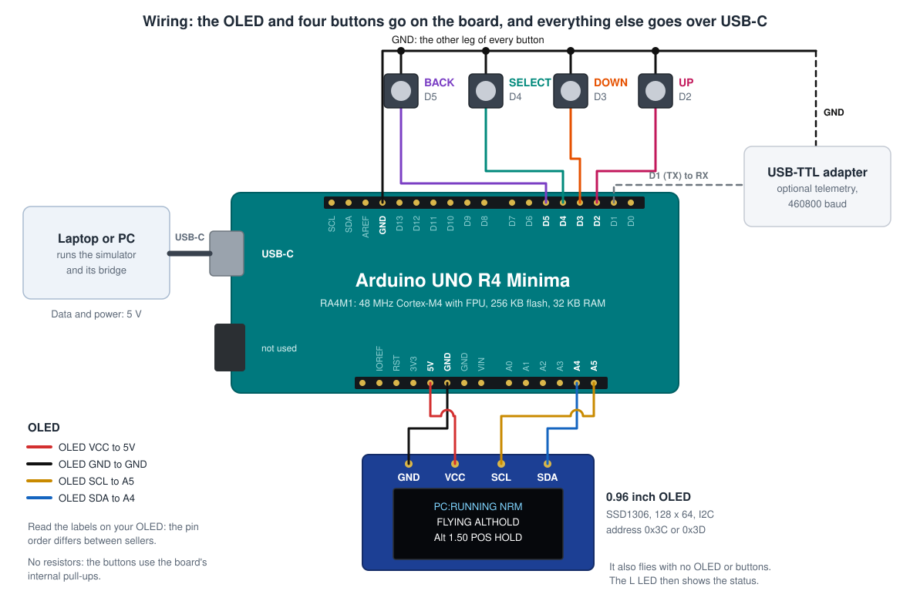

# 2. Wiring

Only the OLED and the 4 buttons are wired. Everything else goes over the USB-C cable. The firmware also runs with neither of them connected.

| From | To R4 pin | Notes |
|---|---|---|
| OLED **GND** | GND | |
| OLED **VCC** | 5V | Most 0.96" modules accept 3.3 to 5 V. |
| OLED **SCL** | A5, or the pin marked SCL near AREF | Same signal. |
| OLED **SDA** | A4, or the pin marked SDA | Same signal. |
| Button **UP** | D2 | The other leg of each button goes to **GND**. |
| Button **DOWN** | D3 | |
| Button **SELECT** | D4 | |
| Button **BACK** | D5 | |
| USB-TTL **RX** (optional) | D1 (TX) | Telemetry at 460800 baud, plus GND to GND. Never connect the adapter's 5V or 3V3 pin. |

To change pins, edit `firmware/AeroFC_R4/board_config.h`.

## Tips for beginners

- **The OLED pin order differs between sellers** (GND-VCC-SCL-SDA or VCC-GND-SCL-SDA). Read the labels printed on your module, not a picture.
- **4-leg tactile buttons:** the two legs on the *same side* are connected inside. Put the button across the breadboard's middle gap and use two legs that are *diagonal* from each other. Then it can't be wired so that it always looks pressed.
- If the display isn't found, the firmware looks for it again every second, so you can plug it in while it runs.

## The L LED

The yellow **L** LED shows the status, with or without a display:

| LED | Meaning |
|---|---|
| Slow blink (1 Hz) | Waiting for the PC simulator |
| Double blink | Simulator connected, disarmed |
| On | Armed (flying) |
| Fast blink | Failsafe or crash |
